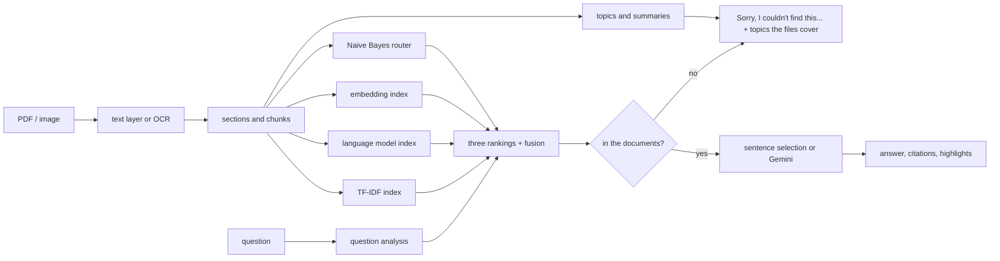

# University Knowledge Assistant

Ask questions about your university's documents (rule books, calendars, circulars, notices) and get an
answer with the page it came from. If the answer is not in the files, it says so instead of guessing.

This is Group 4's project for SNLP 702DB0C028 (NLP). It is a RAG system (retrieval-augmented generation)
where every technique from the course that stayed in the project is a working part of the pipeline.
Techniques that did not improve the results when we measured them were removed. The
[course topics](#course-topics-and-where-they-are-used) section lists both.

## What it does

- Reads PDFs and image files (PNG, JPG, TIFF, BMP, WebP). Scanned pages, photos of notices and pictures
  inside a PDF are read with OCR.
- Splits the text into passages by section and ranks them in three ways at once: TF-IDF keyword search,
  a smoothed unigram language model (query likelihood), and sentence embeddings. The three rankings are
  merged with reciprocal rank fusion.
- Guesses which document the question belongs to (Naive Bayes) and nudges that document up the ranking.
- Answers only from the retrieved passages, picks the sentences that answer the question, highlights them
  in the cited passage and adds a Yes or No for yes/no questions when the wording is clear.
- Refuses questions the documents do not cover, and suggests the topics the files do cover.
- Works without any API key. Add a Gemini key and the answer is written by the model instead.
- Has a Streamlit UI and a FastAPI backend that other programs can call.



## Quick start

You need Python 3.10 or newer. It was developed on 3.13 and the Docker image uses 3.11.

```bash
git clone <your repository url>
cd university-knowledge-assistant
python -m venv .venv
.venv\Scripts\activate          # Windows
source .venv/bin/activate       # macOS / Linux
pip install -r requirements.txt
python run.py
```

`run.py` creates `.env` from `.env.example` if it is missing, starts the API on port 8000 and opens the
UI in your browser. The first start takes a few minutes: it reads every file in `documents/` and
downloads the embedding model (about 90 MB). Later starts reuse what is saved in `storage/`.

Put your files in `documents/`, or upload them from the "Documents" tab in the UI.

To run the two parts yourself:

```bash
uvicorn app.api:app --port 8000
streamlit run app/ui.py
```

### Optional: Gemini answers

Copy `.env.example` to `.env` and set `GOOGLE_API_KEY`. Keys come from https://aistudio.google.com/apikey.
Never commit `.env`. It is already in `.gitignore`.

### Docker

```bash
cp .env.example .env
docker compose up --build
```

API docs at http://localhost:8000/docs, UI at http://localhost:8501. `documents/` and `storage/` are
mounted as volumes.

## How a question is answered

1. **Question analysis** (`app/understanding.py`). The question is tokenized, stopwords are dropped and the
   rest is stemmed. It is also labelled as a when, quantity, who, where, why, how, yes/no, overview or plain
   "what" question. The label decides what kind of sentence is preferred later (a date for "when", a number
   for "how many").
2. **Three rankings** (`app/knowledge_base.py`, `app/lm_retrieval.py`).
   - TF-IDF over stems and adjacent stem pairs. One index covers all documents, so scores are comparable
     between files.
   - Query likelihood: every passage gets a unigram language model, smoothed with the whole collection
     (Dirichlet by default, Jelinek-Mercer and Laplace are also available), and passages are ranked by the
     probability that their model produces the question.
   - Embedding search with MiniLM and FAISS, which finds paraphrases that share no words with the question.
3. **Fusion and routing.** The rankings are merged with reciprocal rank fusion. A Naive Bayes classifier,
   trained on the passages with the document name as the label, estimates which document the question is
   about, and the fused score is multiplied by `1 + ROUTER_BOOST * probability`.
4. **Is it in the files?** (`app/evidence.py`, described below.)
5. **Sentence selection** (`app/answering.py`). Sentences from the retrieved passages are scored by how many
   question words they hold, plus a small bonus for the right kind of content. The best ones are kept, together
   with a neighbouring sentence when it shares a question word. "Tell me about" questions use TextRank
   instead, which picks the most central sentences. For yes/no questions, "Yes." or "No." is put in front
   only when the best sentence matches at least 75% of the question and its wording is clear.
   With a Gemini key the model writes the answer from the same passages, and falls back to the sentences if
   the call fails.
6. **Response.** The answer, a confidence label, the cited passages with the used sentences highlighted, the
   question analysis, the documents the router thinks are most likely, and, when refused, the topics the
   files do cover.

## How it decides whether the answer is in your files

A ranked list always has a first place, even when nothing in it is relevant, and a rank-based score always
makes the top passage look confident. That was the bug in the first version: off-topic questions got an
answer with sources attached.

Now the decision uses absolute signals (all in `app/evidence.py`):

1. How many of the question's content words occur anywhere in the documents.
   "Who won the world cup" fails here because most of those words are not in any file.
2. How many of them occur in the best passage.
3. The cosine similarity from the embedding model, which rescues paraphrases that share no words.
4. An overall strength score. Without an LLM it must be at least 0.50. With Gemini it must be at least 0.35,
   and the model is also told to reply `NOT_FOUND` when the passages do not contain the answer.

If any check fails the response has `evidence_sufficient: false`, confidence `LOW`, no citations and a
"sorry, I couldn't find this" message. Confidence is `HIGH` from strength 0.75, `MEDIUM` from 0.50.

All thresholds are in `.env.example`. To see the numbers for a question:

```bash
python scripts/check_question.py "What is the minimum attendance?" "Who won the world cup?"
```

Limits worth knowing:

- Without an LLM the program cannot judge whether a passage really answers the question, only whether it
  matches the words. That is why the threshold is stricter there.
- The embedding thresholds (`SEMANTIC_STRONG`, `SEMANTIC_FLOOR`) are starting values. They were not
  tuned on real embeddings, so try your own questions and adjust.
- A question can be refused although the answer exists if it is worded very differently from the document.
  [docs/evaluation.md](docs/evaluation.md) has the measured numbers and the list of questions that fail.

## Topics and summaries

When the documents are indexed, the passages are turned into LSA vectors (TF-IDF followed by SVD) and
clustered with k-means (`app/topics.py`). This is used in two places:

- The Documents tab shows the topics, plus keywords and a TextRank summary for each file.
- When a question is refused, the nearest topics are shown, so the person can see what the files do cover.

## OCR

`OCR_ENGINE=auto` uses RapidOCR, which installs with pip and needs no extra software, so it works on
Windows. If it is missing and Tesseract is on your PATH, Tesseract is used. Set `OCR_ENGINE=off` to turn OCR off.

- A PDF page with almost no text (under `OCR_MIN_PAGE_CHARS` characters) is rendered and read.
- On a page that has text and also large pictures, the pictures are read too and merged in without duplicates.
- Table rows from scans are kept on one line, with cells separated by ` | `.
- OCR can misread characters or run words together. The Documents tab shows how many pages of each file
  were read this way. Check dates and numbers in the original.

## Course topics and where they are used

| Module | Topic | Where it is used | Code |
| --- | --- | --- | --- |
| 1. Basic text processing | Tokenization, stemming (Snowball, Porter, Lancaster), sentence splitting, first look at a collection | Every search, the answer check and sentence selection. The collection statistics are on the Documents tab | `app/text_utils.py`, `app/snlp/textproc.py` |
| 2. Language modeling | Unigram language model, zero counts, Laplace, Jelinek-Mercer and Dirichlet smoothing | Second ranking: query likelihood | `app/lm_retrieval.py` |
| 5. Distributional semantics | LSA (SVD of TF-IDF), clustering | Topics: document profiles and the "what the files cover" hint on refusals | `app/topics.py`, `app/corpus.py` |
| 7. Encoders, Transformer, BERT | Contextual sentence embeddings (MiniLM), optional cross-encoder re-ranking, Gemini for generation | Third ranking, the paraphrase part of the answer check, optional answer writing | `app/knowledge_base.py`, `app/generator.py` |
| 8. Classification, summarization | Naive Bayes, TextRank | Naive Bayes guesses the document a question belongs to. TextRank writes the summaries and answers "tell me about" questions | `app/snlp/classify.py`, `app/snlp/summarize.py` |

Modules 3, 4 and 6 (tagging, parsing, word senses) and the n-gram part of module 2 have no place in the final pipeline. See the next section.

### Tried and removed

These were built, connected to the pipeline and measured on the benchmark in `evaluation/`. They did not
improve retrieval, answer selection or the refusal check, so they were taken out instead of being kept as demos.

- **Part-of-speech tagging (HMM, Viterbi)** to weight nouns and verbs in the query: no gain on the benchmark.
- **PCFG and dependency parsing** to boost the head word of the question: no gain.
- **WordNet synonyms, Lesk sense selection and PPMI word vectors** for query expansion: no gain, and extra noise.
- **Kneser-Ney and stupid-backoff n-gram perplexity** as an off-topic signal for the answer check: it did not
  separate off-topic questions from on-topic ones any better than the existing checks.
- **Sentiment classification**: nothing in the pipeline needs it.
- **Inside-outside training and attention visualisation**: only worked as stand-alone demos.

So the syllabus topics for parsing, POS tagging, WordNet and neural language models are not in this
repository. If your course needs to show them, say that they were evaluated and dropped, and point to the
numbers in [docs/evaluation.md](docs/evaluation.md).

## Project layout

```
app/
  api.py              FastAPI app and endpoints
  ui.py               Streamlit UI
  understanding.py    question analysis
  knowledge_base.py   chunking, indexing, the three rankings, fusion, routing
  lm_retrieval.py     query likelihood with smoothing
  evidence.py         the "is it in the documents" check
  answering.py        sentence selection, highlights, yes/no
  generator.py        Gemini answer or sentence answer
  topics.py           LSA + k-means topics, document profiles
  corpus.py           caches the topics and profiles
  ingest.py           PDF and image reading, OCR decisions
  ocr.py              RapidOCR and Tesseract wrappers
  text_utils.py       tokenizing, stopwords, stemmers
  snlp/               sentence splitting, Naive Bayes router, TextRank
documents/            your files go here
evaluation/           benchmark and evaluation script
scripts/              check_question.py, download_nltk_data.py
tests/                pytest suite
docs/                 API reference and evaluation notes
```

## Configuration

Everything is set through environment variables or `.env`. [`.env.example`](.env.example) lists all of them
with comments. The ones you are most likely to change: `GOOGLE_API_KEY`, `SEMANTIC_SEARCH` (set to `false` to
skip the embedding model), `OCR_ENGINE`, `CHUNK_SIZE` and the `MIN_*` thresholds.

## Tests

```bash
pip install -r requirements-dev.txt
pytest
```

The tests run offline. They cover chunking, indexing, the three rankings, the refusal check, sentence
selection, topics, OCR on generated images, the API and the UI. GitHub Actions runs them on every push
(`.github/workflows/ci.yml`).

To measure retrieval and answers on the real files: `python -m evaluation.evaluate`.

## API

See [docs/API.md](docs/API.md). Quick example:

```bash
curl -F "question=What is the minimum attendance?" http://127.0.0.1:8000/api/v1/ask
python examples/client_example.py notice.png "When is the fee due?"
```

## Known limits

- Embedding search, the Gemini path and the Docker setup were not run in the environment where the final
  checks were done (no access to Hugging Face or Google there). They are covered by code and unit tests but
  should be tried on your machine first. All evaluation numbers are for keyword and language-model search only.
- On our 48-question benchmark the assistant refused 7 questions it should have answered, mostly paraphrases
  and two cases where OCR ran words together. It also answered 1 of 18 questions it should have refused.
  The benchmark was written by the team and used while tuning, so these numbers are optimistic.
- The Yes/No prefix is only given for a minority of yes/no questions. When it is missing, read the sentences.
- The first start is slow because of the model download and OCR. Large scanned PDFs can take
  a few seconds per page.
- Answers about dates and numbers from scanned pages depend on OCR quality.
- Documents in `documents/` are institutional and may not be meant for public sharing. Check before you push them
  to a public repository, or add them to `.gitignore`.

## Team

Group 4, SNLP 702DB0C028. Course project, not an official university product.
